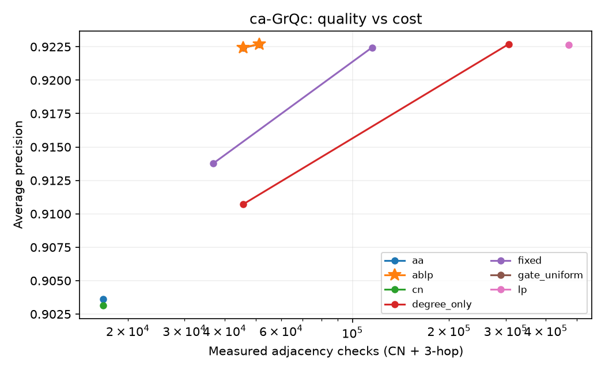
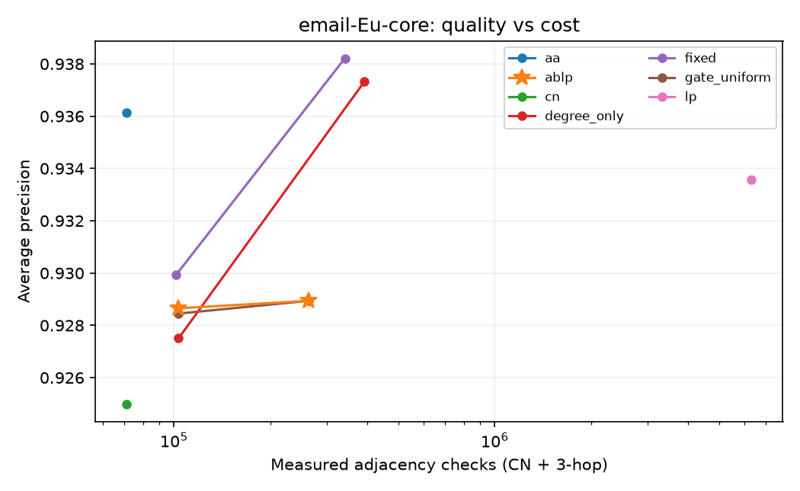

# 阶段一成果与下周汇报材料

本阶段目标是确定题目、实现可解释的算法原型、得到能讨论的初步实验；不是完成最终论文。
当前已完成 22 组小规模实验；一个随机种子只能说明本次划分的现象，不能证明稳定提升或统计显著。

## 1 研究问题和拟议改进

题目：面向稀疏网络的计算预算感知型自适应链接预测。
共同邻居 CN 对无共同邻居的节点对给出相同零分；三跳关系可能帮助区分，但完整搜索有成本。
ABLP 只对 CN=0 的候选扩展三跳，再按训练度数乘积的平方根分配一批候选的总预算。
创新假设是选择性扩展和预算分配是否更划算；三跳技术本身已有研究，不声称首次提出。

## 2 已完成的工程

已实现 CN、AA、完整 LP、固定预算、ABLP 及两个消融版本；具备下载、划分、验证集选参、评分、汇总和恢复入口。
算法接口不接收标签；所有方法使用相同训练图和候选；保留孤立节点，负例排除完整观测图中的已知边。
默认分支 main 使用新版 ABLP 链接预测项目；当前目录仅包含该课题的实现、文档与实验结果。

## 3 实验条件

两个 SNAP 小型网络；seed=42；训练/验证/测试边约 80%/10%/10%；训练保留率 100%；正负例 1:1。
B 取 10、100；epsilon 在验证集从 0.001、0.01、0.1 选择，测试标签不参与选择。
AP（平均精确率）越大越好；表中耗时是本次测试评分的实际时间，桌面负载会影响它，后续应重复计时。
总检查数含 CN 检查与三跳访问，排序和分配成本只反映在时间中。不同方法的实际访问量可能不同。

## 4.1 合作网络 ca-GrQc

预处理后 5242 个节点、14484 条无向边；测试候选 2898 对。
邮件网络忽略原始方向；两者都去自环并合并重复边。

| 方法 | B | AP | 秒 | 总检查数 |
|---|---:|---:|---:|---:|
| cn | 0 | 0.9032 | 0.0263 | 16,741 |
| aa | 0 | 0.9036 | 0.0270 | 16,741 |
| lp | 不限 | 0.9227 | 0.0956 | 471,516 |
| fixed | 10 | 0.9138 | 0.0396 | 36,844 |
| ablp | 10 | 0.9224 | 0.0326 | 45,721 |
| fixed | 100 | 0.9224 | 0.0456 | 115,111 |
| ablp | 100 | 0.9227 | 0.0335 | 51,231 |
| gate_uniform | 100 | 0.9227 | 0.0361 | 51,231 |
| degree_only | 100 | 0.9227 | 0.0730 | 306,541 |

B=100 时，ABLP 相对 fixed 的 AP 差为 +0.0002（+0.02 个百分点），总检查数减少 55.5%。
这不是相同实际成本下的优越性证明，需结合下面的预算曲线讨论。

## 4.2 邮件网络 email-Eu-core

预处理后 1005 个节点、16064 条无向边；测试候选 3214 对。
邮件网络忽略原始方向；两者都去自环并合并重复边。

| 方法 | B | AP | 秒 | 总检查数 |
|---|---:|---:|---:|---:|
| cn | 0 | 0.9250 | 0.0287 | 71,274 |
| aa | 0 | 0.9361 | 0.0365 | 71,274 |
| lp | 不限 | 0.9336 | 0.9068 | 6,322,759 |
| fixed | 10 | 0.9299 | 0.0359 | 101,469 |
| ablp | 10 | 0.9287 | 0.0355 | 103,414 |
| fixed | 100 | 0.9382 | 0.0648 | 340,824 |
| ablp | 100 | 0.9289 | 0.0625 | 262,960 |
| gate_uniform | 100 | 0.9289 | 0.0611 | 262,960 |
| degree_only | 100 | 0.9373 | 0.0802 | 392,674 |

B=100 时，ABLP 相对 fixed 的 AP 差为 -0.0093（-0.93 个百分点），总检查数减少 22.8%。
这不是相同实际成本下的优越性证明，需结合下面的预算曲线讨论。

## 5 本阶段能得出的结论

合作网络的本次划分中，ABLP 在低预算下比固定预算有更高 AP；邮件网络中则出现 AP 低于固定预算的反例。
B=100 时 ABLP 与 gate_uniform 在这两个网络上得到相同 AP，不能据此证明度数加权有独立贡献。
一个可能原因是：门控排除了已有共同邻居的候选，减少成本的同时也放弃了它们之间的三跳排序信息。
这一解释只是机制假设，后续要通过候选子组、消融和多个种子验证，不能凭结果表直接断言因果。

## 6 五分钟汇报提纲

1. 第一分钟：介绍缺失链接预测问题，画 0—1—2—3 说明 CN=0 仍有三跳信息。
2. 第二分钟：说明 ABLP 的两个判断：是否扩展、分多少预算；一次访问是一次邻接关系检查。
3. 第三分钟：展示合作网络的结果和实际检查数，解释 AP 与成本各自代表什么。
4. 第四分钟：主动展示邮件网络反例，说明度数加权尚未证明有效。
5. 第五分钟：说明后续计划，请老师判断该预算分配问题是否满足课程创新要求。

建议收尾：目前我们完成了可运行原型和初步对比，观察到收益与反例并存；接下来会验证收益来自哪个组件，明确适用条件。

## 7 下一阶段及暂缓事项

第 2–3 周先补文献和老师反馈，再锁定评测协议；第 4–5 周做系统实验；第 6 周写初稿；第 7–8 周排版与复核。
详见 roadmap.md。阶段一不生成最终论文 Word/PDF，不继续完整矩阵；当前阶段成果同步至默认分支 main。
此前启动的完整矩阵已暂停，606 组已完成结果保留在 results/course，不能把部分完成当成全部完成。

## 8 复现与来源

运行 scripts/run_stage1.ps1 可重现或恢复本阶段实验；运行 python scripts/build_stage1_report.py 可更新本汇报。
每行数据对应 results/stage1/runs/<dataset>_s42_r1_n1_<method>_b<budget>.json，包含分数文件与划分文件位置。
测试命令：.venv/Scripts/python.exe -m pytest -q；验证证据记录于 docs/validation.md。

相关研究：https://arxiv.org/abs/0901.0553 ；https://arxiv.org/abs/0905.3558 。
官方数据：https://snap.stanford.edu/data/ca-GrQc.html ；https://snap.stanford.edu/data/email-Eu-core.html 。
本汇报中的实验数字来自本仓库本次实际运行，不是这些论文提供的结果。
